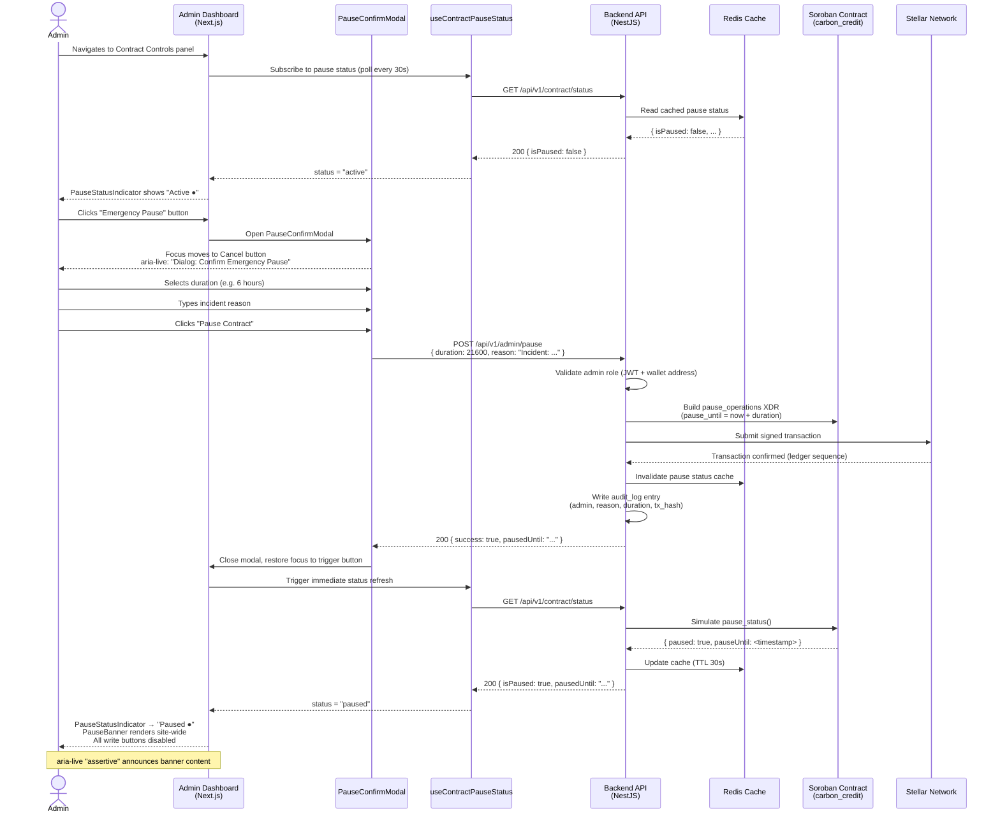
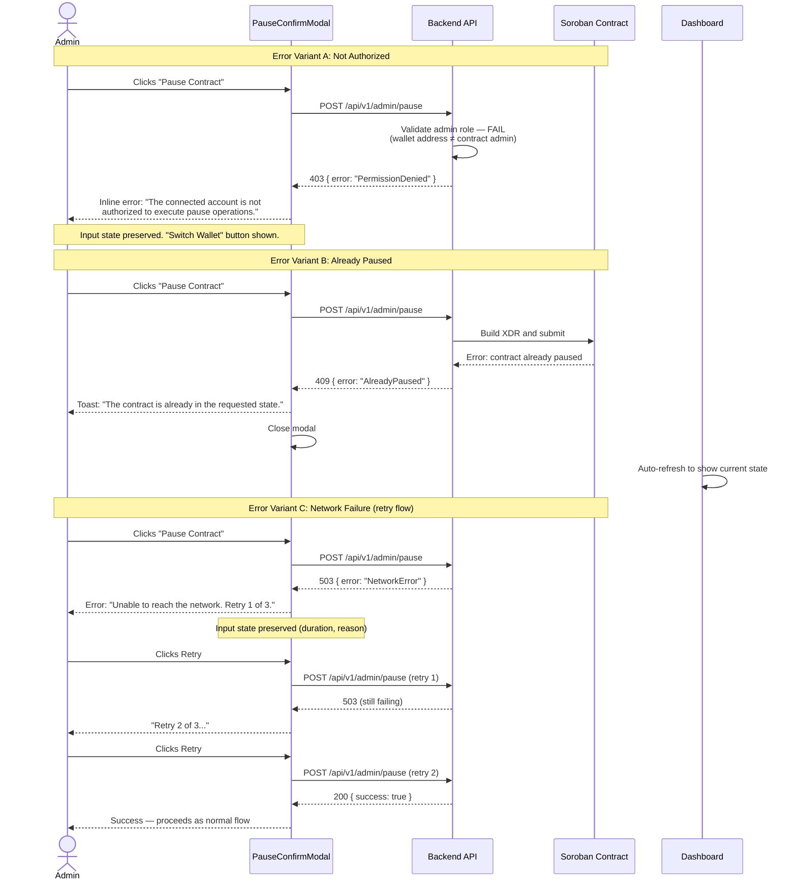
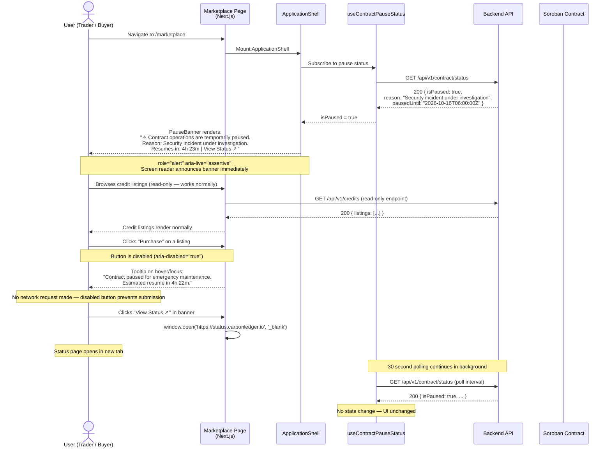
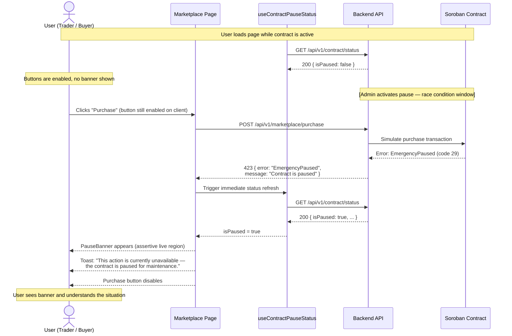
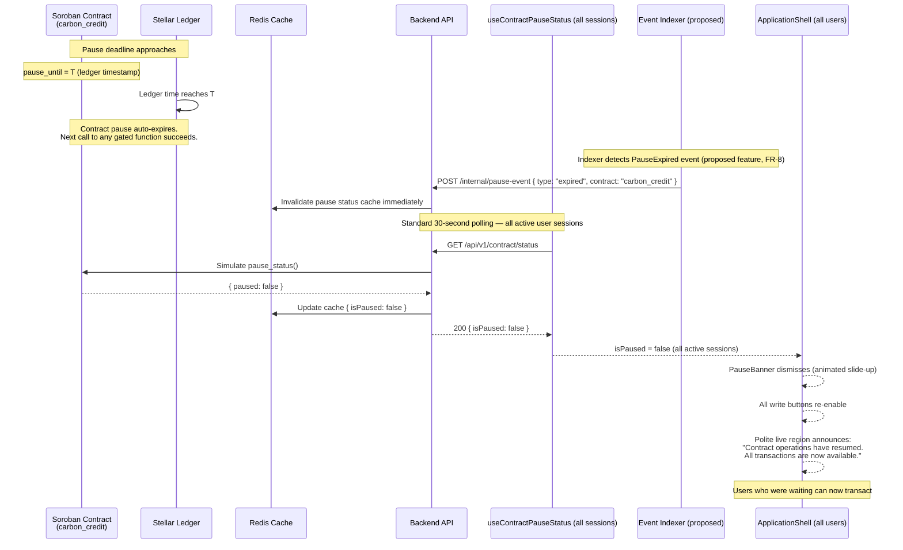
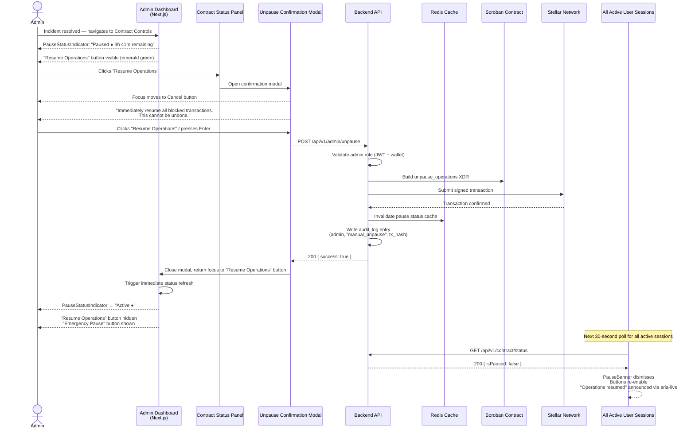
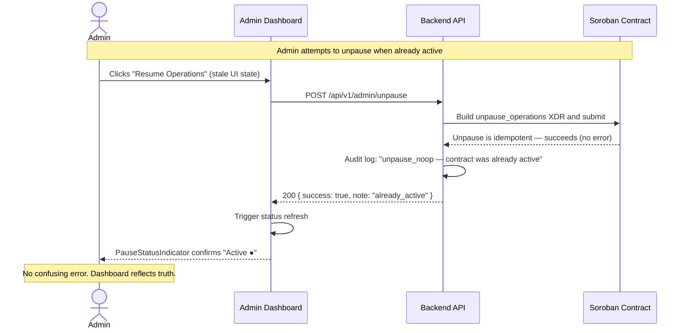
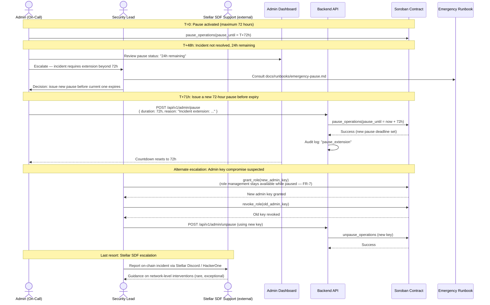
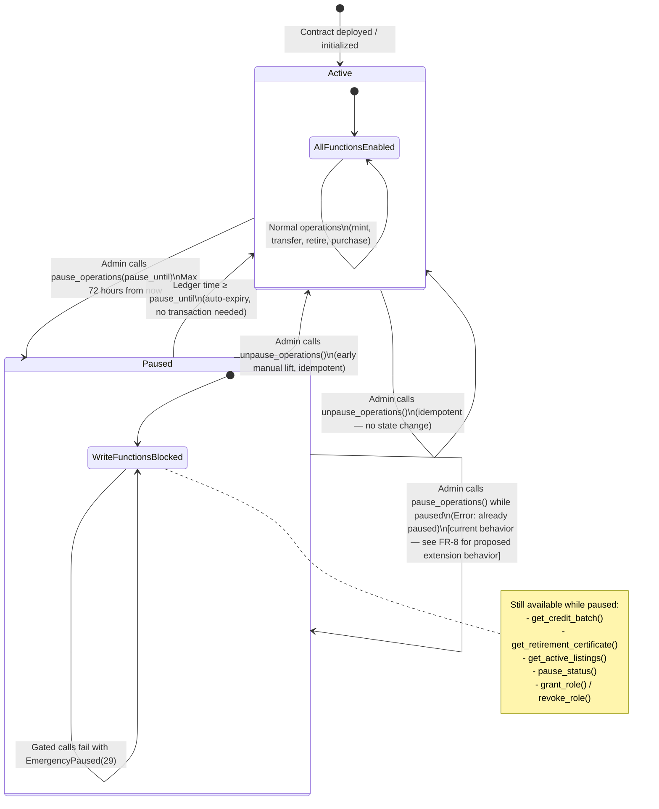

# Pause Feature — User Flow Diagrams

> **Audience**: Frontend engineers, product designers, QA engineers  
> **Scope**: Mermaid sequence diagrams covering every pause-related user journey  
> **Related**: [Pause UX Guide](pause-ux-guide.md) · [Pause Feature Specification](pause-feature/SPECIFICATION.md) · [Emergency Pause Procedures](EMERGENCY_PAUSE_PROCEDURES.md) · [Pause Architecture](pause-architecture.md)

---

## Table of Contents

1. [Overview](#1-overview)
2. [Flow 1 — Admin Pause Activation](#2-flow-1--admin-pause-activation)
3. [Flow 2 — User Encounters a Paused Contract](#3-flow-2--user-encounters-a-paused-contract)
4. [Flow 3 — Pause Expiry and Auto-Lift](#4-flow-3--pause-expiry-and-auto-lift)
5. [Flow 4 — Admin Manual Unpause](#5-flow-4--admin-manual-unpause)
6. [Flow 5 — Emergency Escalation](#6-flow-5--emergency-escalation)
7. [State Diagram — Contract Pause Lifecycle](#7-state-diagram--contract-pause-lifecycle)
8. [Cross-Contract Interaction Map](#8-cross-contract-interaction-map)

---

## 1. Overview

The CarbonLedger pause feature involves four distinct actors communicating across multiple system layers:

| Actor | Role |
|-------|------|
| **Admin** | Initiates and lifts pauses from the admin dashboard or CLI |
| **User** | Corporate buyer, trader, or auditor interacting with the marketplace |
| **Frontend** | Next.js application — renders UI state, polls status, gates buttons |
| **Backend** | NestJS API — validates requests, caches status, writes audit log |
| **Soroban Contract** | `carbon_credit` or `carbon_marketplace` — enforces pause on-chain |
| **Stellar Network** | Submits and confirms transactions |

The diagrams in this document trace the full journey through all layers for each major scenario. They are intended to be used:
- As a **reference for frontend engineers** implementing or modifying pause UI
- As a **test specification** for QA writing end-to-end tests
- As a **communication tool** for design reviews and incident post-mortems

---

## 2. Flow 1 — Admin Pause Activation

This is the primary operational flow: an administrator detects an incident and issues a pause within the 5-minute SLA.



### Error Variants — Pause Activation



---

## 3. Flow 2 — User Encounters a Paused Contract

This flow covers the most common user-facing scenario: a buyer or trader arrives at the marketplace while it is paused.



### Sub-flow: User Submits Transaction During Race Condition

A rare but important edge case: the pause is activated after the user loads the page but before they submit a transaction.



---

## 4. Flow 3 — Pause Expiry and Auto-Lift

The Soroban contract enforces a hard maximum of 72 hours. When the expiry timestamp is reached, the pause lifts automatically at the contract level. This flow shows how the frontend detects and reflects that change.



### Timeline Notes

- Maximum detection lag = 30 seconds (polling interval).
- If the event indexer (FR-8) is implemented, detection lag drops to < 5 seconds.
- Until the indexer is live, all sessions rely on the 30-second poll.
- The 30-second poll is acceptable per NFR-3 ("off-chain pause status is at most 30s stale").

---

## 5. Flow 4 — Admin Manual Unpause

When an incident is resolved before the pause deadline, the admin can lift the pause early.



### Idempotency



---

## 6. Flow 5 — Emergency Escalation

When a pause alone is insufficient — for example, if the pause expiry is approaching and the incident is not resolved, or if the admin key itself may be compromised — the escalation protocol activates.



---

## 7. State Diagram — Contract Pause Lifecycle



---

## 8. Cross-Contract Interaction Map

`carbon_marketplace` calls `carbon_credit` internally during purchases. Both contracts are independently pausable, and a pause on either blocks the cross-contract call chain.

```mermaid
flowchart TD
    subgraph User["User Action"]
        U1([User clicks Purchase])
    end

    subgraph Frontend["Frontend (Next.js)"]
        F1[Check carbon_marketplace pause status]
        F2{Marketplace paused?}
        F3[Disable Purchase button]
        F4[Build purchase transaction XDR]
        F5[Submit to Soroban RPC]
    end

    subgraph Marketplace["carbon_marketplace contract"]
        M1[purchase_credits() entry]
        M2{check_not_paused}
        M3[Validate listing, price, buyer balance]
        M4[Call carbon_credit.transfer_credits()]
        M5[Transfer USDC to seller]
        M6[Emit PurchaseCompleted event]
    end

    subgraph Credit["carbon_credit contract"]
        C1[transfer_credits() entry]
        C2{check_not_paused}
        C3[Execute credit transfer]
    end

    U1 --> F1
    F1 --> F2
    F2 --> |Yes| F3
    F2 --> |No| F4
    F4 --> F5
    F5 --> M1
    M1 --> M2
    M2 --> |Paused| E1[Error: EmergencyPaused 29\nreturned to frontend]
    M2 --> |Not paused| M3
    M3 --> M4
    M4 --> C1
    C1 --> C2
    C2 --> |Paused| E2[Error: EmergencyPaused 29\npropagated back through marketplace]
    C2 --> |Not paused| C3
    C3 --> M5
    M5 --> M6
    M6 --> SUCCESS([Transaction complete])

    E1 --> HANDLE[Frontend maps to pause banner + toast]
    E2 --> HANDLE

    style E1 fill:#fee2e2,stroke:#ef4444
    style E2 fill:#fee2e2,stroke:#ef4444
    style F3 fill:#fef3c7,stroke:#f59e0b
    style SUCCESS fill:#d1fae5,stroke:#10b981
```

### Key observation

Both `carbon_credit` and `carbon_marketplace` must be unpaused for a purchase to succeed. If only one is paused, the cross-contract call will still fail. The frontend should check both statuses independently and show a combined banner that clarifies which contract(s) are affected:

> "⚠ `carbon_marketplace` is paused for maintenance. Purchases are currently unavailable."

vs.

> "⚠ Both `carbon_credit` and `carbon_marketplace` are paused. All transactions are unavailable."

---

## Related Documentation

| Document | Description |
|----------|-------------|
| [Pause UX Guide](pause-ux-guide.md) | Interaction patterns, error handling, accessibility, and mobile guidelines |
| [Pause Feature Specification](pause-feature/SPECIFICATION.md) | Contract-level requirements, state model, and architecture |
| [Pause Architecture](pause-architecture.md) | System architecture diagrams and data flow |
| [Emergency Pause Procedures](EMERGENCY_PAUSE_PROCEDURES.md) | Step-by-step incident response runbook |
| [Pause API Reference](pause-api-reference.md) | Backend endpoints and contract function signatures |
| [Pause Security Analysis](pause-security-analysis.md) | Threat model and attack surface for the pause mechanism |
| [ADR-013: Emergency Pause](adr/ADR-013-emergency-pause.md) | Architecture decision record for the pause design |

---

*Last updated: October 2026 · Issue #1269*
