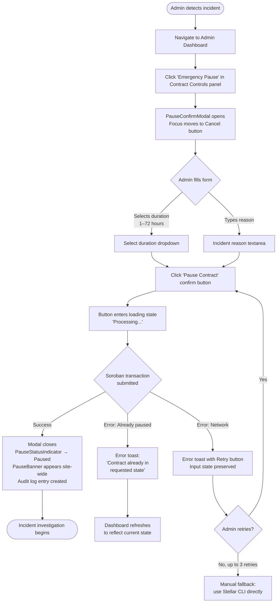
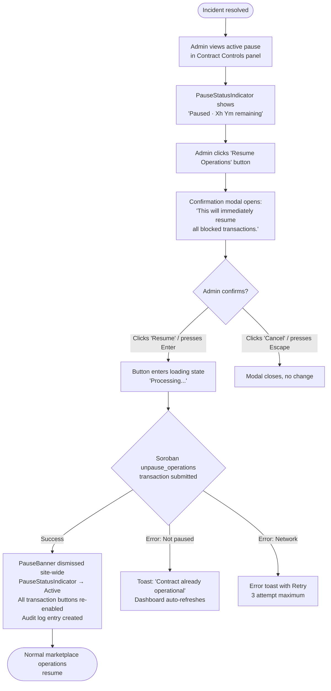
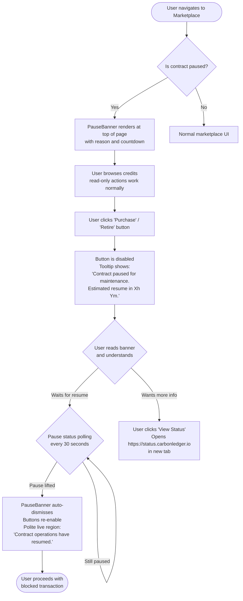

# Pause Feature — Comprehensive UX Guide

> **Audience**: Frontend engineers, product designers, QA engineers  
> **Scope**: UI/UX patterns, interaction design, accessibility, and mobile considerations for the CarbonLedger emergency pause feature  
> **Related**: [Pause Feature Specification](pause-feature/SPECIFICATION.md) · [Pause User Flow Diagrams](pause-user-flow-diagrams.md) · [Pause API Reference](pause-api-reference.md) · [Pause Accessibility Report](pause-feature-accessibility-report.md) · [Pause Error Codes](pause-error-codes-reference.md)

---

## Table of Contents

1. [Overview and Purpose](#1-overview-and-purpose)
2. [User Personas](#2-user-personas)
3. [User Flow Diagrams](#3-user-flow-diagrams)
4. [Interaction Patterns](#4-interaction-patterns)
5. [Error Handling Guidelines](#5-error-handling-guidelines)
6. [Accessibility Requirements](#6-accessibility-requirements)
7. [Mobile Considerations](#7-mobile-considerations)
8. [Component Quick Reference](#8-component-quick-reference)

---

## 1. Overview and Purpose

The CarbonLedger emergency pause mechanism is a time-boxed circuit breaker that an admin activates to stop all write operations on a Soroban contract during a security incident, a suspected exploit, or a bad oracle feed. From a user's perspective, the pause feature must accomplish three things simultaneously:

1. **Protect users** — prevent transactions from being submitted to a contract that is behaving unexpectedly, avoiding financial loss or invalid state.
2. **Inform users** — clearly communicate that the platform is paused, why it happened, when it will resume, and what they can still do in the meantime.
3. **Enable recovery** — give administrators a fast, unambiguous control surface to activate or lift a pause within the 5-minute SLA defined in the specification.

### Key Design Constraints

- **Per-contract scope**: `carbon_credit` and `carbon_marketplace` each have independent pause flags. `carbon_registry` and `carbon_oracle` are never paused.
- **Time-bounded**: Every pause has a hard maximum of **72 hours** enforced by the smart contract. The UI must never let an admin set a duration beyond this.
- **Read-only access preserved**: Browsing the marketplace, viewing retirement certificates, and looking up serial numbers always remain available. The UI must make this clear so users do not assume the entire platform is down.
- **Status freshness**: Off-chain pause status must be at most **30 seconds stale**. Poll `/api/v1/contract/status` every 30 seconds, or maintain a WebSocket connection to push status updates.

---

## 2. User Personas

Three distinct personas interact with the pause feature. Their needs differ substantially, and the UI must serve each without confusion.

### 2.1 Admin / Operator

**Who**: Contract administrator, security lead, on-call SRE.  
**Context**: Responding to an active security incident, a bad oracle feed, or a serial-number conflict. May be under significant time pressure and stress.  
**Goals**:
- Activate an emergency pause within 5 minutes of making the decision.
- Set a meaningful pause duration (1–72 hours) and document an incident reason.
- Monitor the countdown and remaining time from the admin console.
- Lift the pause early once the incident is resolved.

**UX priorities**:
- The pause control must be immediately visible and reachable from the admin dashboard — no more than two clicks from the main menu.
- The confirmation modal must be fast and unambiguous, with prominent danger-colored branding that prevents accidental activation.
- Keyboard accessibility is critical: on-call engineers may be navigating exclusively via keyboard during an incident.
- Duration helper text must explain the 72-hour hard cap and the auto-expiry behavior.

### 2.2 Trader / Corporate Buyer

**Who**: Corporate sustainability officer, treasury operations lead, or fund manager transacting on the marketplace.  
**Context**: Attempting to purchase, transfer, or retire carbon credits when a pause is active.  
**Goals**:
- Understand immediately why their transaction cannot proceed.
- Know when the platform will resume (remaining countdown).
- Continue browsing credits and reviewing their portfolio while waiting.
- Not lose any work-in-progress (cart contents, retirement form data).

**UX priorities**:
- Proactive notification via a persistent banner — users must not discover the pause by receiving an unexpected error on transaction submission.
- All transaction-gating buttons (Purchase, Transfer, Retire) must be visibly disabled with a clear tooltip explaining the reason.
- The banner must show a human-readable countdown: e.g., "Operations resume in approximately 4h 23m".
- Cart and form state must be preserved across the pause period so nothing needs to be re-entered.

### 2.3 Auditor / Public User

**Who**: Regulator, journalist, ESG analyst, or any public visitor verifying retirement certificates or audit trails.  
**Context**: Accessing read-only views — audit explorer, serial number lookup, public certificates — during a pause.  
**Goals**:
- Verify that a retirement certificate is legitimate.
- Look up the history of a carbon credit serial number.
- Understand whether a pause affects the validity of historical records.

**UX priorities**:
- Read-only views must continue working without interruption.
- A non-alarmist informational banner should explain that marketplace transactions are temporarily paused, but the audit trail is fully intact and unaffected.
- No wall-of-error pages. These users did not attempt a transaction and should not see a transaction-failure UI.

---

## 3. User Flow Diagrams

For the complete set of detailed mermaid sequence diagrams, see [Pause User Flow Diagrams](pause-user-flow-diagrams.md). The following are the three primary flows.

### 3.1 Admin Pause Activation Flow



### 3.2 Admin Manual Unpause Flow



### 3.3 User-Facing Blocked Transaction Flow



---

## 4. Interaction Patterns

### 4.1 Pause Banner

The `PauseBanner` is the primary mechanism for site-wide pause notification.

**Placement**: Mount globally in the application shell, above the navigation bar. It must be the first visible content on every page so users see it before encountering disabled buttons.

**Visual design**:
- Emergency pause (security incident): Red/rose background (`#E11D48`) with white text (contrast ratio 4.88:1, WCAG AA pass).
- Scheduled maintenance pause: Amber/yellow background with dark text — distinguishable from emergency tone.
- Banner must not be dismissible during the first 60 seconds after render (prevents premature dismissal before the user reads it).
- After 60 seconds, a dismiss button appears with `aria-label="Dismiss pause notification"`.

**Content**:
```
⚠ CarbonLedger contract operations are temporarily paused.
   Reason: [Admin-provided reason]   |   Resumes in: [countdown]   |   [View Status ↗]
```

**Behavior**:
- Uses `role="alert"` and `aria-live="assertive"` so screen readers announce it immediately on render.
- The countdown timer updates every minute (not every second, to avoid excessive re-renders and live region noise).
- When the pause lifts, the banner auto-dismisses. A polite live region announces: "Contract operations have resumed. All transactions are now available."

**DO NOT**:
- Show the banner only on specific routes (e.g., checkout). It must be global.
- Show an empty or generic "Something went wrong" error when an API returns 409/423. Map these to the pause banner.
- Let the pause status go more than 60 seconds stale.

### 4.2 Button States

All write-action buttons (Purchase, Transfer, Retire, List Credits, Delist) must follow this state machine when a pause is active:

| State | Visual | Behavior |
|-------|--------|----------|
| **Normal** | Filled, colored (green/blue) | Submits transaction on click |
| **Paused** | Grayed out, opacity 0.5 | `disabled` attribute set. Hover/focus shows tooltip: *"Contract paused for emergency maintenance. Estimated resume in Xh Ym."* |
| **Loading** | Spinner + "Processing…" text | `disabled` attribute set. `aria-busy="true"`. Button width fixed to prevent layout shift. |
| **Error** | Returns to normal, error toast shown | Allows retry. Input state preserved. |

**Implementation pattern**:
```tsx
<button
  type="button"
  disabled={isPaused || isLoading}
  aria-disabled={isPaused || isLoading}
  title={isPaused ? `Contract paused. Estimated resume in ${timeRemaining}` : undefined}
>
  {isLoading ? <Spinner aria-hidden /> : null}
  {isLoading ? 'Processing…' : 'Purchase'}
</button>
```

**Important**: Use both `disabled` and `aria-disabled`. `disabled` prevents the click handler. `aria-disabled="true"` combined with `tabIndex={0}` allows keyboard users to focus the button and read the tooltip — do this when you want the pause reason to be discoverable via keyboard.

### 4.3 Pause Confirmation Modal

The `PauseConfirmModal` is the gatekeeper before an admin activates a pause. It must make the action feel weighty without being obstructive.

**Opening behavior**:
- Focus must move to the Cancel button on open (safer default — prevents accidental confirmation).
- Focus is trapped inside the modal while it is open.
- `Escape` key closes the modal (equivalent to Cancel).
- Background is obscured with a semi-transparent overlay.

**Form fields**:

| Field | Type | Validation | Helper text |
|-------|------|-----------|------------|
| Pause duration | Dropdown (`<select>`) | 1–72 hours (enforced at client and contract level) | "Pauses expire automatically after the selected duration. Maximum 72 hours per smart contract rules. Extend by issuing a new pause if mitigation takes longer." |
| Incident reason | Textarea | Required, 10–500 characters | "Visible to all administrators in the audit log. Be specific: e.g., 'Suspected serial-number conflict in batch CRB-2026-0041'." |

**Button layout**:
- Cancel (left / secondary) — neutral styling, no destructive color.
- Pause Contract (right / primary) — rose/red background, `data-testid="confirm-pause-btn"`.
- Do NOT use a single "OK" button. The destructive nature requires explicit labeling.

**Confirmation text** (renders above buttons):
> "This will immediately halt all marketplace purchases, credit transfers, and retirements until the selected time or until you manually resume. Read-only actions (browsing, certificate lookup) will remain available."

### 4.4 Status Indicator

The `PauseStatusIndicator` component renders a dot + label in three states:

| Status | Dot color (light) | Dot color (dark) | Label |
|--------|-------------------|------------------|-------|
| `active` | `#15803d` (green-700) | `#4ade80` (green-400) | "Active" |
| `paused` | `#b45309` (amber-700) | `#fbbf24` (amber-400) | "Paused" |
| `idle` | `#475569` (slate-600) | `#cbd5e1` (slate-300) | "Idle" |

**Placement**: Header bar (small variant, `size="sm"`). Admin dashboard contract controls panel (large variant). Both the `carbon_credit` and `carbon_marketplace` statuses should be shown separately since each contract is independently pausable.

**Polling**: The hook `useContractPauseStatus` must poll `/api/v1/contract/status` every 30 seconds while the user has an active session. On tab blur, polling may be suspended to reduce server load; it must resume immediately on tab focus.

**Live region**: The indicator uses `role="status"` and `aria-live="polite"`. Status changes from Active → Paused use `aria-live="assertive"` (state change is urgent). Changes from Paused → Active use `aria-live="polite"` (good news, non-urgent).

---

## 5. Error Handling Guidelines

### 5.1 Error Classification

Pause-related errors fall into three categories with distinct UX treatments:

**Category A — User-actionable errors** (the user can fix these):

| Error Code | HTTP / Contract Code | User-Facing Message | Recovery UI |
|-----------|---------------------|--------------------|----|
| Permission denied | HTTP 403 | "The connected account is not authorized to execute pause operations. Switch to an admin wallet in Freighter." | Inline alert with "Switch Wallet" deep-link button |
| Invalid duration | Contract validation | "Invalid pause duration. Choose between 1 and 72 hours." | Dropdown snaps back to last valid value |
| Wallet not connected | UI state | "Connect your Freighter wallet to continue." | "Connect Wallet" primary button |

**Category B — System errors** (retry is the correct response):

| Error Code | HTTP / Contract Code | User-Facing Message | Recovery UI |
|-----------|---------------------|--------------------|----|
| Network disruption | HTTP 502/503 | "Unable to reach the network. Check your connection." | Retry button (max 3 attempts, exponential backoff: 2s, 4s, 8s) |
| RPC timeout | Soroban simulation timeout > 10s | "The transaction is taking longer than expected. Retrying…" | Auto-retry once, then show manual Retry button |
| RPC node unavailable | HTTP 503 | "The Stellar RPC node is temporarily unavailable." | Retry button + link to status page |

**Category C — Informational** (no action needed from user):

| Error Code | HTTP / Contract Code | User-Facing Message | Display |
|-----------|---------------------|--------------------|----|
| Already paused | Contract `EmergencyPaused (29)` | "The contract is already paused." | Toast notification. Dashboard auto-refreshes. |
| Already active | Contract state check | "The contract is already operational." | Toast notification. |
| Transaction in flight | UI concurrency | "A pause operation is already in progress." | Loading state on button. |

### 5.2 Contract Error Code `EmergencyPaused (29)`

This is the most important error to handle at the UI level. When a user submits a transaction and the RPC returns `EmergencyPaused` (contract error code 29), the application **must not** show a raw "transaction failed" error. Instead:

1. Intercept the error in the Soroban transaction result handler.
2. Trigger a pause status refresh immediately.
3. Render the `PauseBanner` if not already visible.
4. Show a toast: *"This action is currently unavailable because the contract is paused for maintenance."*
5. Disable the triggering button.

This scenario should be rare if the banner is rendering correctly, but it can happen if a pause is activated in the window between a user loading the page and submitting a transaction.

**Implementation pattern**:
```typescript
try {
  const result = await submitSorobanTransaction(tx);
  // handle success
} catch (error) {
  if (isSorobanError(error, ContractError.EmergencyPaused)) {
    // Trigger status refresh and banner
    await refreshPauseStatus();
    showToast({
      type: 'warning',
      message: 'This action is currently unavailable — the contract is paused for maintenance.',
    });
    return; // do not surface raw error
  }
  // handle other errors normally
}
```

### 5.3 Input State Preservation

When any error occurs during a pause-related modal action (activation, unpause confirmation), the user's input must be preserved:

- **Pause duration selection**: Keep the selected option in component state.
- **Incident reason text**: Keep the textarea value in component state.
- **Do not reset the form** on error — only reset on successful submission or deliberate Cancel.

This is critical because admins under incident pressure should not have to retype their incident description after a transient network error.

### 5.4 Retry Limits

To prevent API hammering during an incident (when backend load may already be elevated):

- Maximum **3 automatic retry attempts** per user action.
- Use exponential backoff: 2s, 4s, 8s between attempts.
- After 3 failed attempts, surface a manual Retry button and a link to the status page.
- Display attempt counter in the error message: *"Retry 2 of 3…"*

---

## 6. Accessibility Requirements

CarbonLedger pause UI components are **WCAG 2.1 Level AA compliant** as verified in the [Pause Feature Accessibility Report](pause-feature-accessibility-report.md). The following requirements must be maintained for all future changes.

### 6.1 WCAG 2.1 AA Compliance Checklist

All pause UI changes must satisfy these criteria before merging:

- [ ] **1.1.1 Non-text Content**: All icons have `aria-hidden="true"` and are accompanied by visible or hidden text labels.
- [ ] **1.3.1 Info and Relationships**: Status conveyed through color is also conveyed through text (never color-only).
- [ ] **1.3.3 Sensory Characteristics**: Instructions do not rely solely on shape, color, size, or position.
- [ ] **1.4.1 Use of Color**: Paused state is not identified by color alone — the word "Paused" or an icon + label is always present.
- [ ] **1.4.3 Contrast (Minimum)**: All text and text-in-components meets 4.5:1 contrast ratio. See color tokens in section 4.4.
- [ ] **1.4.11 Non-text Contrast**: UI components (borders, focus rings, status dots) have at least 3:1 contrast against adjacent colors.
- [ ] **2.1.1 Keyboard**: All interactive elements are reachable and operable by keyboard alone.
- [ ] **2.1.2 No Keyboard Trap**: Modals implement bidirectional focus trapping (`Tab` and `Shift+Tab`), but `Escape` always releases focus.
- [ ] **2.4.3 Focus Order**: Focus order within modals is logical. On open: Cancel button. On close: returns to the element that triggered the modal.
- [ ] **2.4.7 Focus Visible**: All focusable elements have a visible focus ring: `focus-visible:outline-2 focus-visible:ring-2 focus-visible:ring-offset-2`.
- [ ] **2.5.3 Label in Name**: Button accessible names must contain the visible text label.
- [ ] **4.1.2 Name, Role, Value**: All form controls have programmatic labels (`<label htmlFor>` or `aria-label`).
- [ ] **4.1.3 Status Messages**: Status changes are announced via ARIA live regions without moving keyboard focus.

### 6.2 ARIA Patterns

**Emergency Banner** (`PauseBanner`):
```tsx
<div
  role="alert"
  aria-live="assertive"
  aria-atomic="true"
>
  {/* Banner content */}
  <button aria-label="Dismiss pause notification">×</button>
</div>
```

**Status Indicator** (`PauseStatusIndicator`):
```tsx
<span
  role="status"
  aria-live="polite"
  aria-label={`Contract status: ${statusLabel}`}
>
  <span aria-hidden="true">●</span>
  {statusLabel}
</span>
```

**Pause Button** (`PauseButton`):
```tsx
<button
  type="button"
  aria-pressed={paused}
  aria-label={paused ? 'Resume operations' : 'Pause contract'}
  aria-describedby="pause-status-live"
>
  {/* icon + label */}
</button>
<span
  id="pause-status-live"
  role="status"
  aria-live="polite"
  className="sr-only"
>
  {announcement} {/* "Paused" or "Resumed" */}
</span>
```

**Pause Confirm Modal** (`PauseConfirmModal`):
```tsx
<div
  role="dialog"
  aria-modal="true"
  aria-labelledby="pause-modal-title"
  aria-describedby="pause-modal-description"
>
  <h2 id="pause-modal-title">Confirm Emergency Pause</h2>
  <p id="pause-modal-description">
    This will halt all write operations for the selected duration.
  </p>
  <label htmlFor="pause-duration-select">Duration</label>
  <select id="pause-duration-select" aria-describedby="pause-duration-help">
    {/* options */}
  </select>
  <span id="pause-duration-help">Maximum 72 hours per contract design.</span>
  <label htmlFor="pause-reason-input">Incident reason</label>
  <textarea id="pause-reason-input" aria-required="true" />
</div>
```

### 6.3 Keyboard Navigation

The complete keyboard interaction model for pause components:

| Component | Key | Action |
|-----------|-----|--------|
| `PauseButton` | `Enter` / `Space` | Toggles pause state / opens confirm modal |
| `PauseConfirmModal` | `Tab` | Cycles focus: Cancel → Duration → Reason → Confirm → Cancel |
| `PauseConfirmModal` | `Shift+Tab` | Reverse cycle |
| `PauseConfirmModal` | `Escape` | Closes modal, returns focus to trigger button |
| `PauseConfirmModal` | `Enter` on Confirm | Submits confirmation |
| `PauseBanner` | `Tab` to dismiss button, `Enter` / `Space` | Dismisses banner |
| `PauseStatusIndicator` | Not interactive | (read-only, no keyboard interaction needed) |
| `PauseOverlay` | `Tab` | Cycles: Resume → Restart (if present) → Quit (if present) → Resume |
| `PauseOverlay` | `Escape` | Should NOT dismiss — pause overlay is intentional |

### 6.4 Screen Reader Behavior

**VoiceOver / NVDA / JAWS expected announcements**:

| Event | Expected announcement |
|-------|-----------------------|
| Banner appears on page load | "Alert: CarbonLedger contract operations are temporarily paused. [reason]. Estimated resume in Xh Ym." |
| Status changes Active → Paused | "Contract status: Paused 4 hours remaining" |
| Status changes Paused → Active | "Contract status: Active" |
| Modal opens | "Dialog. Confirm Emergency Pause. This will halt all write operations for the selected duration. [first focusable element announced]" |
| Pause submitted successfully | "Paused" (via live region on `PauseButton`) |
| Unpause submitted successfully | "Resumed" (via live region on `PauseButton`) |
| Error occurs | Error toast content announced via `aria-live="polite"` |

---

## 7. Mobile Considerations

The pause UI has been tested across 6 device/OS combinations (see [Pause UI Mobile Testing Report](pause-ui-mobile-testing-report.md)). The following requirements apply to all mobile implementations.

### 7.1 Touch Target Sizes

Per WCAG 2.5.5 / 2.5.8 and Apple HIG / Material Design guidelines, all interactive pause UI elements must have minimum tap targets of **44×44px** (48×48px preferred):

| Component | Minimum size | Implementation |
|-----------|-------------|----------------|
| `PauseBanner` dismiss button | 44×44px | `min-w-[44px] min-h-[44px]` |
| `PauseButton` | 44×44px | `py-3 px-4` on mobile |
| `PauseConfirmModal` Cancel button | 44×44px | Full-width on mobile |
| `PauseConfirmModal` Confirm button | 44×44px | Full-width on mobile |
| Duration dropdown trigger | 44px height | `h-11` (`44px`) |
| Status indicator dot | Not interactive | N/A |

On mobile, the Cancel and Confirm buttons stack vertically (column layout) at viewports below 640px, giving each full width for maximum tap surface.

### 7.2 Responsive Breakpoints

| Breakpoint | Banner layout | Modal layout | Button layout |
|------------|--------------|--------------|---------------|
| `< 640px` (mobile) | Single column, full-width | Full-screen bottom sheet or full-width centered | Stacked vertically, full-width |
| `640px–1024px` (tablet) | Two-column with action link | Centered modal, max-width 480px | Side-by-side, 50% width each |
| `> 1024px` (desktop) | Full banner with countdown inline | Centered modal, max-width 520px | Side-by-side, auto width |

The modal at mobile sizes must use `max-h-[90vh] overflow-y-auto` to prevent the confirm button from being pushed off-screen by the virtual keyboard when the textarea is focused.

### 7.3 Virtual Keyboard Handling

When the admin opens the pause confirmation modal on mobile and focuses the incident reason textarea:

1. The virtual keyboard will push the viewport upward.
2. The modal must scroll internally (not the page background) to keep both the textarea and the Confirm button visible.
3. Use `overflow-y-auto` on the modal inner container, not `overflow-hidden`.
4. Test with both iOS Safari (which resizes the viewport) and Android Chrome (which overlays the keyboard).

Avoid `position: fixed` for the confirm button on mobile — it can clash with the virtual keyboard in Safari. Use natural document flow within the scrollable modal container instead.

### 7.4 Mobile-Specific Interaction Patterns

**Backdrop dismiss**: On mobile, tapping outside the modal triggers a "Cancel" confirmation to avoid accidental dismissal. On desktop, backdrop click dismisses directly (there is less risk of accidental touch).

**Swipe-to-dismiss banner**: The `PauseBanner` supports swipe-left to dismiss on touch devices after the 60-second non-dismissible window. The swipe threshold is 50% of banner width to prevent accidental dismissal.

**Haptic feedback** (progressive enhancement): On supported devices, use the Web Vibration API to provide a brief haptic pulse (50ms) on pause confirmation — this reinforces the gravity of the action without being disruptive:
```typescript
if ('vibrate' in navigator) {
  navigator.vibrate(50); // 50ms pulse on pause confirm
}
```

### 7.5 Landscape Orientation

All pause modals must remain fully usable in landscape orientation on mobile devices:

- iPhone SE landscape (568×320): Modal must scroll within `max-h-[90vh]`.
- iPhone 14 landscape (844×390): Modal fits without scrolling.
- Galaxy S22 landscape (800×360): Modal fits without scrolling.

Test at **568px viewport height** as the minimum supported landscape height.

### 7.6 Offline / Reduced Connectivity

On slow or intermittent connections (common in mobile scenarios):

- The pause status must be cached in `localStorage` with a 60-second TTL.
- If the API call to `/api/v1/contract/status` fails, use the cached value and show a subtle indicator: *"Status last updated [X] seconds ago."*
- Do not show "Unknown status" — use the last known value with the staleness indicator.
- Transaction buttons should default to disabled when status is unknown, to protect users from submitting to a potentially paused contract.

---

## 8. Component Quick Reference

| Component | File | Props | Used In |
|-----------|------|-------|---------|
| `PauseButton` | `src/components/PauseButton.tsx` | `paused`, `onToggle`, `label?`, `disabled?` | Admin contract control panel |
| `PauseOverlay` | `src/components/PauseOverlay.tsx` | `isPaused`, `onResume`, `onRestart?`, `onQuit?` | Full-screen pause overlay (non-contract use cases) |
| `PauseStatusIndicator` | `src/components/PauseStatusIndicator.tsx` | `status: 'active'|'paused'|'idle'`, `label?` | Header bar, admin dashboard |
| `PauseBanner` | `src/components/pause/PauseBanner.tsx` | `isPaused`, `reason`, `pausedUntil`, `onViewDetails` | Application shell (global layout) |
| `PauseConfirmModal` | `src/components/pause/PauseConfirmModal.tsx` | `open`, `onConfirm`, `onCancel` | Admin pause activation trigger |

**Hook**: `useContractPauseStatus` — polls `/api/v1/contract/status` every 30s, returns `{ isPaused, reason, pausedUntil, status }`.

**Integration example** (application shell):
```tsx
import { PauseBanner, PauseStatusIndicator } from '@/components/pause';
import { useContractPauseStatus } from '@/hooks/useContractPauseStatus';

export function ApplicationShell({ children }: { children: React.ReactNode }) {
  const { isPaused, reason, pausedUntil, status } = useContractPauseStatus();
  return (
    <div className="min-h-screen flex flex-col">
      <PauseBanner
        isPaused={isPaused}
        reason={reason}
        pausedUntil={pausedUntil}
        onViewDetails={() => window.open('https://status.carbonledger.io', '_blank')}
      />
      <header className="border-b px-6 py-4 flex items-center justify-between">
        <h1 className="text-xl font-bold">CarbonLedger</h1>
        <PauseStatusIndicator status={status} size="sm" />
      </header>
      <main className="flex-1 p-6">{children}</main>
    </div>
  );
}
```

---

## Related Documentation

| Document | Description |
|----------|-------------|
| [Pause User Flow Diagrams](pause-user-flow-diagrams.md) | Complete sequence diagrams for all pause scenarios |
| [Pause Feature Specification](pause-feature/SPECIFICATION.md) | Contract-level design, requirements, and architecture |
| [Pause API Reference](pause-api-reference.md) | Backend API endpoints for pause/unpause operations |
| [Pause Error Codes Reference](pause-error-codes-reference.md) | All pause-related error codes and frontend mapping |
| [Pause Accessibility Report](pause-feature-accessibility-report.md) | WCAG 2.1 AA audit results and screen reader testing |
| [Pause UI Mobile Testing Report](pause-ui-mobile-testing-report.md) | Device matrix and responsive design test results |
| [Pause UI Usage Guidelines](pause-ui-usage-guidelines.md) | Implementation patterns and common pitfalls |
| [Pause UI Usability Test Report](pause-ui-usability-test-report.md) | Usability study results with admin/operator participants |
| [Pause UI Error States Guide](pause-ui-error-states-guide.md) | Error classification and resilience strategies |
| [Emergency Pause Procedures](EMERGENCY_PAUSE_PROCEDURES.md) | Step-by-step operational runbook for incident response |

---

*Last updated: October 2026 · Issues #1301, #1269*
